<p align="center">
  <a href="https://maitsam-kadzim.my.id">
    
  </a>
</p>

<p align="center">
  <a href="https://maitsam-kadzim.my.id"></a>
  <a href="https://www.linkedin.com/in/maitsam-kadzim-12ba50301/"></a>
  <a href="mailto:maitsamkadzim26@gmail.com"></a>
</p>

<p align="center">
  
</p>

---

## `~/about`

```bash
~/KuroiiDev $ cat about.md
```

I'm Sam, a backend-focused full stack developer who builds clean, performant web apps and APIs. I study Computer Engineering at Diponegoro University and enjoy Laravel, mobile with Flutter, and network security on the side.

```yaml
role:      Full Stack Developer (backend-focused, web-first)
studying:  Computer Engineering @ Diponegoro University
strengths: [Laravel, REST APIs, Flutter, MySQL]
exploring: [Next.js, Docker, network security]
open_to:   [internships, collaborations, backend / full stack projects]
```

---

## `~/stack`

```bash
~/KuroiiDev $ skills --list
```

**Backend**  


**Frontend**  


**Mobile**  


**Database & Tools**  


---

## `~/projects`

```bash
~/KuroiiDev $ ls -l ./projects --sort=pinned
```

| Project | What it does | Stack |
|---|---|---|
| **[Encryptour](https://github.com/Encryptour/encryptour-web)** | Web profile and student database for the 2024 Computer Engineering batch at Diponegoro University | `Laravel` `PHP` `Tailwind CSS` `Vercel` |
| **[Berkah App](https://maitsam-kadzim.my.id/projects)** | Full stack management system for raw materials, financial tracking, and project/task management | `PHP` `JavaScript` `Ajax` `CSS` |
| **[Geeks User](https://github.com/KuroiiDev/smk5-geeks-user-app.git)** | Mobile book borrowing app, built as a vocational school final project | `Flutter` `Dart` |

```bash
~/KuroiiDev $ open https://maitsam-kadzim.my.id/projects
```

---

## `~/stats`

```bash
~/KuroiiDev $ github-stats --user=kuroiidev
```

<p align="center">
  
  
</p>

---

## `~/contact`

```bash
~/KuroiiDev $ open --contact
```

- Portfolio: [maitsam-kadzim.my.id](https://maitsam-kadzim.my.id)
- LinkedIn: [maitsam-kadzim](https://www.linkedin.com/in/maitsam-kadzim-12ba50301/)
- Email: [maitsamkadzim26@gmail.com](mailto:maitsamkadzim26@gmail.com)

```bash
~/KuroiiDev $ echo "Thanks for stopping by!"
Thanks for stopping by!
```

<p align="center">
  <sub>Crafted with ♥ by KuroiiDev · 2026</sub>
</p>
